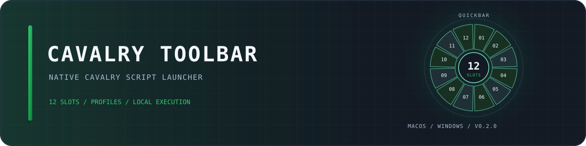

# Cavalry Toolbar

面向 **Cavalry 2.8** 的原生脚本轮盘与配置编辑器。用固定快捷键管理 12 个稳定脚本槽位，提供同心圆弧名称、Filee 式逐片退场和减少动效回退。

[English README](README.md) · [下载 v0.2.0](https://github.com/luoboruodai/cavalry-toolbar/releases/tag/v0.2.0) · [安装指南](docs/INSTALL.zh-CN.md) · [CI](https://github.com/luoboruodai/cavalry-toolbar/actions/workflows/ci-release.yml)

**v0.2.0** · Cavalry 2.8 · macOS 12+ 通用版 · Windows 10/11 x64

<div align="center">



[](https://github.com/luoboruodai/cavalry-toolbar/actions/workflows/ci-release.yml)
[](https://github.com/luoboruodai/cavalry-toolbar/releases/tag/v0.2.0)

</div>

## 发布状态

| 产品 | 状态 | 平台 |
| --- | --- | --- |
| Cavalry Toolbar | `v0.2.0` · 已发布 | macOS 12+ 通用版 · Windows 10/11 x64 |

## 功能

- **12 个稳定槽位与多配置**：绑定普通 `.js` / `.jsc` 脚本或 UI 面板，切换配置不改变槽号。
- **原生轮盘**：同心圆弧名称，鼠标／滚轮／方向键选择，点击／回车运行，`` ` ``／Shift+`` ` `` 切换配置。
- **配置编辑器**：扫描或添加脚本、编辑配置、拖动交换已绑定槽位、导入／导出配置。
- **有意义的动效**：悬停／按下反馈、成功交换的中心脉冲，以及鼠标退场时逐片缩小／扭转／淡出。减少动效时状态变化保持即时。
- **本地、有限的执行**：不安装常驻服务或全局键盘监听，不把脚本源码或可执行路径交给原生助手。

## 下载

| 安装包 | 平台 | 内容 |
| --- | --- | --- |
| [CavalryToolbar-v0.2.0-macOS-universal.zip](https://github.com/luoboruodai/cavalry-toolbar/releases/download/v0.2.0/CavalryToolbar-v0.2.0-macOS-universal.zip) | macOS 12+，Apple Silicon 与 Intel | 两个编辑器脚本、通用 AppKit 助手、验收夹具、双语离线指南 |
| [CavalryToolbar-v0.2.0-Windows-x64.zip](https://github.com/luoboruodai/cavalry-toolbar/releases/download/v0.2.0/CavalryToolbar-v0.2.0-Windows-x64.zip) | Windows 10/11 x64 | 两个编辑器脚本、PowerShell/WinForms 助手、验收夹具、双语离线指南 |
| [SHA256SUMS.txt](https://github.com/luoboruodai/cavalry-toolbar/releases/download/v0.2.0/SHA256SUMS.txt) | 全部 | 两个安装包的 SHA-256 校验值 |

**安装请使用上述附件，不要把 GitHub 自动生成的 “Source code” ZIP 当作安装包。**

[发布说明](https://github.com/luoboruodai/cavalry-toolbar/releases/tag/v0.2.0) · [安装指南](docs/INSTALL.zh-CN.md) · [English installation](docs/INSTALL.md)

## 平台说明

### macOS

- 通用 `arm64` + `x86_64` AppKit 助手。
- 助手为 **ad-hoc 开发签名，未公证**。不要绕过 macOS 安全警告。
- 只有普通快捷键需要通过 Cavalry 的 Scripts 菜单打开 **UI 面板或配置页** 时才需要辅助功能权限；普通脚本选择与取消不需要。
- 重建或替换 ad-hoc 助手会改变 CDHash，旧的“已开启”记录可能不再匹配；必要时重新添加当前助手。

### Windows

- 使用 **Windows PowerShell 5.1（powershell.exe）** 与 .NET Framework WinForms，不设置 `ExecutionPolicy Bypass`，不修改系统策略；PowerShell 7（pwsh）不是本次验收运行时。
- 真实 Windows CI 覆盖原生表单与句柄创建、按键事件、配置切换、取消与有限等待。
- 尚未覆盖**已登录 Cavalry 宿主内的 Windows 端到端验收**。请先使用包内场景中立夹具验证，再运行生产脚本。
- Windows 普通快捷键的 UI 面板分派已改用绑定实际 Cavalry PID 的 UI Automation；外部 `.jsc` 仍需安装到 Cavalry Scripts。
- Windows 原生轮盘已补齐悬停／按下反馈与 Filee 式逐片退场，并支持减少动效。

## 安装与使用

1. 阅读 [安装指南](docs/INSTALL.zh-CN.md) 或 [Installation](docs/INSTALL.md)，将包内 `Scripts` 的内容复制到 Cavalry 的 Scripts 目录。
2. 打开 `CavalryToolbar`，添加／扫描脚本，选择运行模式并绑定槽位。
3. 在 Cavalry Shortcut Manager 中为 `CavalryQuickbarPanel` 分配一个快捷键。
4. 用鼠标、滚轮或方向键选择，点击或回车运行。Esc、中心点击、右键或点击外部取消。
5. `` ` `` 切换到下一配置，Shift+`` ` `` 返回上一配置。

**编辑配置不会执行脚本或修改 Scene。你自己的脚本可能修改 Scene，运行前请先保存工程。**

## 构建与测试

开发环境需要 Node.js、Python 3；macOS 还需要 Apple Command Line Tools。Windows 助手测试在 Windows PowerShell 中运行。

```sh
node scripts-build.mjs
native/macos/build.sh
node --test tests/host-smoke.test.mjs tests/toolbar.test.mjs tests/ui-relay.test.mjs tests/wheel.test.mjs
tests/macos/run.sh
python3 packaging/build_release.py
```

Windows：

```powershell
tests/windows/run.ps1
```

发布工作流会先通过源码测试、AppKit 事件模型、真实 WinForms 检查、通用打包和归档字节校验，再上传 Release。

## 安全与隐私

- 原生助手只接收显示名称、槽号、运行模式与可用状态；只返回动作、配置索引和槽位索引，不返回可执行路径。
- Cavalry 会根据自己的配置校验索引，再加载脚本。
- 不安装网络服务、遥测、后台守护进程或全局键盘监听。
- macOS 仅在轮盘打开期间观察外部鼠标按下，关闭即移除。辅助功能 UI 分派是范围限定在 Cavalry Scripts 菜单的一次性动作。

## 许可证

[MIT](LICENSE) © 2026 luoboruodai
